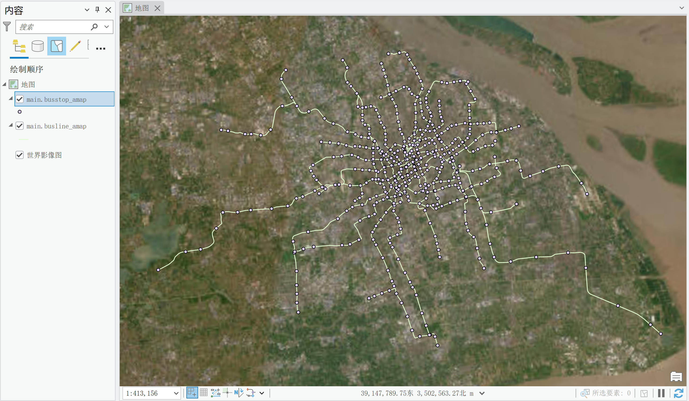
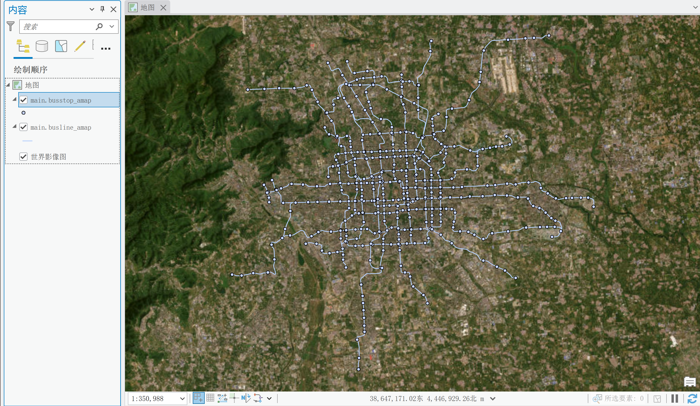
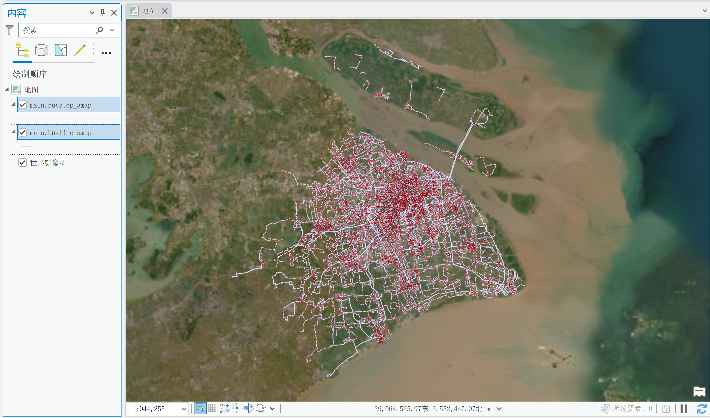
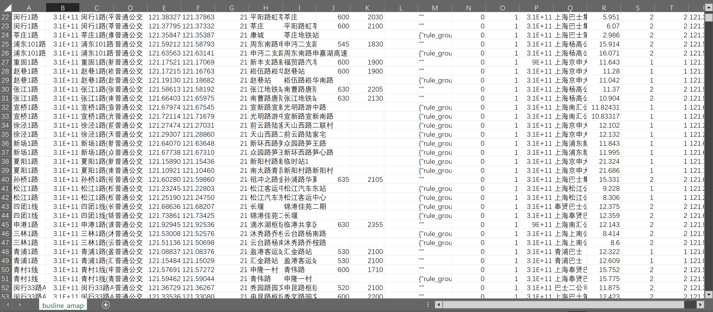

# busline-crawler

从**高德地图** / **百度地图** API 抓取城市公交（地铁）线路、站点与轨迹，输出
**GeoPackage** / **GeoJSON** / **JSON**  / **TXT** 的开源工具。










> ⚠️ **免责声明**：本工具仅用于学习、研究与个人数据采集。使用者需自行遵守高德/百度地图开放平台的服务条款，确保抓取行为合法合规，控制抓取频率，并对自身使用行为负责。


## 特性

- 🚌 **高德**：官方 Web 服务 API（`/v3/bus/linename`），**零第三方依赖**，纯标准库即可运行；
- 🌐 **百度**：JS API `BMap.BusLineSearch`，通过 Playwright 无头浏览器自动化；
- 🗺️ **坐标转换**：高德 GCJ-02、百度 BD-09 → WGS84（EPSG:4326）；
- 📦 **统一输出**：GeoPackage（线路 LineString + 站点 Point 双图层，WGS84 / EPSG:4326）、GeoJSON、txt；
- 🔑 **高德多 Key 轮换** + 内置 QPS 限速（适配 5000 次/日、30 QPS 配额）；
- 📋 保存 API 返回的**全量字段**（含高德 `timedesc` 发车时刻表解码）；
- 🧹 **自动去重**：数字穷举时同一条线路会被多个关键字重复命中，脚本按规范化后的线路名自动去重（采集侧 + 输出前双重兜底），避免重复入库。

## 目录结构

```
.
├── pyproject.toml                # 打包配置（pip install -e . 后全局可用 busline 命令）
├── src/busline/                  # 程序包（src 布局）
│   ├── __init__.py               # 包信息与 __version__
│   ├── cli.py                    # 统一入口（busline amap | baidu）
│   ├── busline_crawler.py        # 高德抓取核心库（零依赖）
│   └── baidu_busline_playwright.py   # 百度抓取核心库（需 Playwright）
├── configs/                      # 配置文件目录
│   ├── example.yaml              # 配置文件模板（检索参数；复制为 config.yaml 使用）
│   └── keys.txt.example          # 密钥模板（复制为 keys.txt，存放地图平台 Key）
├── docs/                         # 文档
│   ├── 高德公交线路API字段说明.md
│   └── 百度公交线路API字段说明.md
└── runs/                         # 抓取数据输出目录（默认）
```

## 快速开始

### 安装

```bash
# 高德版零依赖，直接安装即可全局使用 busline 命令
pip install -e .

# 百度版需额外安装 Playwright（等价于 pip install -e ".[browser]"）
pip install -e ".[browser]" && playwright install chromium
```

### 方式一：统一入口 `busline`

```bash
# 高德（零依赖）
busline amap --city 上海 --lines "406路" --gpkg

# 百度（先装依赖）
busline baidu --city 上海 --lines "406路" --gpkg
```

### 方式二：配置文件驱动（推荐，参数多时最省事）

```bash
# 1. 用模板生成自己的配置文件
cp configs/example.yaml configs/config.yaml
# 2. 编辑 configs/config.yaml，填入 provider / city 等检索参数（密钥放 configs/keys.txt，见下文）
# 3. 直接运行（不指定数据源时自动读取 configs/config.yaml 里的 provider）
busline
# 也可显式指定数据源，命令行参数会覆盖配置文件
busline baidu --city 北京 --only "机场线"
```

## 配置高德地图 API Key

1. 打开 [高德开放平台](https://lbs.amap.com/) → 注册/登录 → 「控制台 → 应用管理 → 创建新应用」，**服务平台选择「Web 服务」**；
3. 配额说明：公交线路关键字 API 免费额度 **5000 次/日**、并发上限 **30 次/秒**
   （脚本默认 QPS 28，已内置限速）。

## 配置百度地图 API Key

1. 打开 [百度地图开放平台](https://lbsyun.baidu.com/) → 控制台 → 创建应用；
2. 申请 **浏览器端 AK**（`BusLineSearch` 属 JS API，**必须用浏览器端 Key**，服务端 Key 不可用）；
3. **设置 Referer 白名单**，放行 `http://127.0.0.1:9`（Playwright 内部拦截地址）或你的部署域名。
   > 白名单未放行 `127.0.0.1` 时，会出现「脚本能加载但检索全返回 0 条」的静默失败。
4. 说明：`BusLineSearch` 是免费基础能力、无配额限制，但强依赖浏览器环境。

## 配置文件（可选，推荐）

所有参数都可在配置文件里设置，程序启动时默认读取配置文件作为参数默认值，
**命令行参数会覆盖配置文件**（优先级：命令行 > 配置文件 > 内置默认值）。

### 使用步骤

```bash
cp configs/example.yaml configs/config.yaml   # 复制模板
# 编辑 configs/config.yaml，填入 provider / city 等检索参数（密钥放 configs/keys.txt，见上文）
busline                        # 不传数据源时自动读取 configs/config.yaml 的 provider
```

### 配置结构

```yaml
provider: baidu            # 默认数据源（amap | baidu）
city: 上海                 # 通用：城市名
outdir: runs               # 通用：根输出目录
# 密钥不在此配置文件，放在 configs/keys.txt（amap=xxx / baidu=yyy）

amap:                      # 高德专属参数
  max_num: 1000
  max_qps: 28.0
  lines: ""
  exact: false             # 精确检索（true=只留短名全等的线路）
  gpkg: false

baidu:                     # 百度专属参数
  max_num: 1000
  delay_ms: 1000
  timeout: 0               # 抓取总超时秒数（0=自动计算，保证全量穷举不被截断）
  only: ""
  exact: false             # 精确检索（true=只留短名全等的线路）
  gpkg: false
```

配置键名与命令行参数一一对应，完整字段见后续“命令行参数”部分。

### 注意事项

- 布尔开关（`gpkg` / `geojson` / `headed`）命令行**只能开启、无法覆盖为关闭**——配置文件设了 `true` 就会生效。

## 命令行参数

> 下表「默认」为内置默认值；实际值优先取配置文件，命令行显式传入的参数优先级最高。全局参数 `-c/--config` 用于指定配置文件（放在子命令前，如 `busline --config my.yaml amap`）。

### `busline amap`

| 参数 | 默认 | 说明 |
|---|---|---|
| `--city` | `上海` | 城市名 |
| `--amap-key` | 空（读 `configs/keys.txt` 的 `AMAP_KEY`） | 高德 Key，多 key 逗号分隔 |
| `--lines` | 空 | 指定线路，逗号分隔（留空则数字穷举全城市） |
| `--prefix` | 空 | 线路名前缀，逗号分隔；与 `--lines` 组合生成「前缀+线路」关键字（如 `--prefix 浦东 --lines 102路` → `浦东102路`）；数字穷举模式下与 `--suffix` 组合成「前缀+数字+后缀」 |
| `--suffix` | 空 | 数字后缀，逗号分隔；**仅数字穷举模式生效**，与 `--prefix` 组合（如 `--prefix 浦东 --suffix 路 --max-num 30` → `浦东1路~浦东30路`） |
| `--extra` | 配置文件的 `extra` | 额外特殊关键字，逗号分隔；默认值在配置文件 `extra` 字段（模板为高铁、旅游、观光、接驳线、夜、假日、高峰、机场），**留空 = 不追加**（纯数字穷举）。仅数字穷举模式生效，不与 `--lines` 组合 |
| `--only` | 空 | 只检索指定关键字，逗号分隔；**不做数字穷举**（模糊匹配，可命中含该词的所有线路） |
| `--exact` | 关 | 精确检索开关：开启后**只保留短名与关键字严格全等**的线路（不做补路/补线回退，如 `406` 不匹配 `406路`）；默认关闭 = 模糊检索 |
| `--max-num` | `1000` | 数字穷举上限 |
| `--max-qps` | `28.0` | QPS 上限（硬上限 30） |
| `--delay` | `0.0` | 每次请求间隔秒数，可在 QPS 限速之外进一步降低请求频率 |
| `--gpkg` | 关 | 输出 GeoPackage |
| `--geojson` | 关 | 输出 GeoJSON 线要素 |
| `--outdir` | `runs` | 根输出目录，数据写入其下按命名规则自动生成的子文件夹 |

### `busline baidu`

| 参数 | 默认 | 说明 |
|---|---|---|
| `--city` | `上海` | 城市名 |
| `--baidu-ak` | 空（读 `configs/keys.txt` 的 `BAIDU_AK`） | 百度浏览器端 AK |
| `--lines` | 空 | 指定线路，逗号分隔（默认模糊检索；加 `--exact` 才按短名精确过滤，见下方说明） |
| `--prefix` | 空 | 线路名前缀，逗号分隔；与 `--lines` 组合生成「前缀+线路」关键字（如 `--prefix 浦东 --lines 102路` → `浦东102路`）；数字穷举模式下与 `--suffix` 组合成「前缀+数字+后缀」 |
| `--suffix` | 空 | 数字后缀，逗号分隔；**仅数字穷举模式生效**，与 `--prefix` 组合（如 `--prefix 浦东 --suffix 路 --max-num 30` → `浦东1路~浦东30路`） |
| `--extra` | 配置文件的 `extra` | 额外特殊关键字，逗号分隔；默认值在配置文件 `extra` 字段（模板为高铁、旅游、观光、接驳线、夜、假日、高峰、机场），**留空 = 不追加**（纯数字穷举）。仅数字穷举模式生效，不与 `--lines` 组合 |
| `--only` | 空 | 只检索指定关键字，逗号分隔；**不做数字穷举**（模糊匹配，可命中含该词的所有线路） |
| `--exact` | 关 | 精确检索开关：开启后**只保留短名与关键字严格全等**的线路（不做补路/补线回退，如 `406` 不匹配 `406路`）；默认关闭 = 模糊检索 |
| `--max-num` | `1000` | 数字穷举上限 |
| `--delay-ms` | `1000` | 请求间隔毫秒 |
| `--timeout` | `0`（自动） | 抓取总超时秒数；`0` = 自动按「关键字数 × 间隔 + 余量」计算，保证全量穷举不被截断 |
| `--headed` | 关 | 显示浏览器窗口（默认无头） |
| `--gpkg` | 关 | 输出 GeoPackage |
| `--outdir` | `runs` | 根输出目录，数据写入其下按命名规则自动生成的子文件夹 |

> **关于 `--timeout` 抓取总超时**：百度 `BusLineSearch` 是浏览器异步回调，内嵌 JS 按 `--delay-ms` 间隔逐个发送关键字，并设有兜底超时以避免回调丢失时永久卡死。默认 `--timeout 0` 时，脚本按「关键字数 × 间隔 + 余量」**自动计算**兜底超时，保证「全量穷举（1000+ 关键字）」不会被固定超时提前截断；若确需显式控制最长等待时间，可传 `--timeout <秒>`（此时可能因等待不足而提前返回部分结果）。

> **关于 `--exact` 精确检索**：高德、百度两边的线路检索都是**模糊匹配**——百度`BusLineSearch.getBusList()` 传 `浦东102路` 会同时命中「102路」「浦东107路」等含相同字样的线路；高德 `/v3/bus/linename` 的 `keywords` 同样是模糊匹配。加 `--exact` 后，脚本会在检索结果里**按线路短名严格全等过滤**，只保留短名与关键字完全一致的线路（不做补路/补线回退：例如，关键字 `406` 不会匹配 `406路`，需写全 `406路`）。注意：精确过滤是「在已返回的结果里筛」，不会减少请求次数与配额。

> **`--only` / `--lines` / `--prefix` / `--suffix` / `--extra` / `--exact` 的区别**：
> - `--extra` 只在「数字穷举」模式生效，**不会**与 `--lines` 拼接组合，只是往穷举队列后面追加几个词；
> - `--prefix` 有两种用途：配合 `--lines` 生成「前缀+线路」关键字，或在数字穷举模式下配合 `--suffix` 生成「前缀+数字+后缀」；
> - `--suffix` 只在「数字穷举」模式生效，给数字关键字追加后缀（如「路」）；
> - `--lines` 指定线路检索，默认**模糊**命中（适合不确定完整线路名时）；加 `--exact` 才按短名精确过滤；
> - `--only` 只检索给定关键字，**不做数字穷举**，默认模糊命中全部保留。
>   适合「机场」这类**前缀词**——`--only "机场"` 能完整拿到「机场一线、机场二线、…、机场七线」等全部含「机场」的线路；
> - `--exact` 是精确检索总开关，作用于上述所有模式：开启后只保留短名与关键字**严格全等**的线路。适合「机场1线~机场10线」这类确切线路名——`--prefix 机场 --suffix 线 --max-num 10 --exact`只会留下机场1线~机场10线，滤掉误命中数据。

## 检索情景速查

`--lines` / `--prefix` / `--suffix` / `--extra` / `--only`（以及精确开关 `--exact`）可按需组合，覆盖「指定线路、按词抓取、批量路号、全量穷举」四类需求。先给一张速查表，再逐情景举例。

| 参数 | 定位 | 生效条件 |
|---|---|---|
| `--lines` | 指定**完整线路名**检索 | 独立使用，可配 `--prefix` |
| `--only` | 只检索给定**关键词**（模糊命中） | 优先级最高，与其他检索参数互斥 |
| `--prefix` | 前缀 | 配 `--lines` 组合线路名；或配 `--suffix` 做数字穷举 |
| `--suffix` | 数字后缀 | **仅数字穷举模式**，配 `--prefix` |
| `--extra` | 追加特殊关键词 | **仅数字穷举模式**，往队列末尾追加 |
| `--exact` | 精确过滤总开关 | 作用于所有模式；不加 = 模糊 |

优先级：`--only` > `--lines` > 数字穷举；`--suffix`、`--extra` 只在数字穷举模式生效。

### 单参数情景

**① `--lines` 抓已知线路**

```bash
busline baidu --city 上海 --lines "406路,406路大站车"
```

适合手里有明确线路名清单、一次抓多条。默认**模糊**命中；要只留完全匹配的线路，追加 `--exact`。

**② `--only` 抓主题/前缀词线路**

```bash
busline baidu --city 上海 --only "机场"
```

适合抓「机场一线~机场七线」这类**含某词的所有线路**，模糊命中、不过滤。

**③ `--extra` 数字穷举 + 补充特殊线路**

```bash
busline amap --city 上海 --extra "机场,旅游"
```

适合全量抓取时，数字穷举（1~1000）覆盖不到「机场线、旅游线」这类非数字命名线路，追加进队列。

**④ 默认全量穷举（什么都不传）**

```bash
busline amap --city 上海
```

检索 `1~1000` + 配置文件默认的 8 个特殊词（高铁、旅游、观光、接驳线、夜、假日、高峰、机场）。

### 组合情景

**⑤ `--prefix` + `--suffix` 批量连续路号**

```bash
busline baidu --city 上海 --prefix "浦东" --suffix "路" --max-num 30
# → 浦东1路、浦东2路、…、浦东30路
```

适合「地区名 + 连续路号」；加 `--exact` 可只留短名全等的线路。

**⑥ `--lines` + `--prefix` 多条线路套同一前缀**

```bash
busline baidu --city 上海 --lines "102路,107路" --prefix "浦东"
# → 浦东102路、浦东107路
```

适合多个路号都要加上同一个地区前缀。

**⑦ 穷举 + 前后缀 + 特殊词（最强组合）**

```bash
busline amap --city 上海 --prefix "浦东" --suffix "路" --max-num 30 --extra "机场,旅游"
# → 浦东1路~浦东30路 + 机场 + 旅游
```

**⑧ `--prefix` + `--suffix` 抓城市地铁线**

```bash
busline amap --city 上海 --prefix "地铁" --suffix "号线" --max-num 10
# → 地铁1号线、地铁2号线、…、地铁10号线
```

### 会被「忽略」的组合（别踩坑）

| 组合 | 结果 |
|---|---|
| `--suffix` 配 `--lines` | `--suffix` 被忽略（打提示），只在穷举模式生效 |
| `--extra` 配 `--lines` | `--extra` 被忽略，不与 `--lines` 拼接 |
| `--only` 配其他检索参数 | 其他全忽略，`--only` 独占 |

> 一句话记法：**`--only` 是「只搜这个词」，`--lines` 是「指定这几条线路」，`--prefix` 是「给前面加地名」，`--suffix` 是「给数字后面加单位」，`--extra` 是「穷举完再补几个」，`--exact` 是「只留完全匹配的」。**

## 输出文件

> 所有输出默认写入 `runs/` 目录下按命名规则自动生成的子文件夹（可用 `--outdir` 自定义根目录）。

### 输出目录命名规则

每次运行都会在根输出目录下自动生成一个子文件夹，命名格式：

```
<YYYYMMDD_HHMMSS>_<provider>_<城市>_<模式>_<关键字>/
```

示例：

```
runs/
├── 20261024_181231_baidu_上海_only_机场线/
├── 20261024_183045_amap_上海_lines_406路/
└── 20261024_183500_baidu_上海_full_1-1000/
```

| 字段 | 说明 |
|---|---|
| `YYYYMMDD_HHMMSS` | 运行时间戳，零填充、放最前（字典序 = 时间序，排序即最新在前） |
| `provider` | `amap` / `baidu`（区分地图平台） |
| `城市` | 城市名 |
| `模式` | `only`（只检索）/ `lines`（指定线路）/ `full`（数字穷举） |
| `关键字` | 检索关键字（多关键字用下划线连接；`full` 模式记为 `1-<max-num>`） |

### 高德（`busline amap`）

| 文件 | 格式 | 输出方式 | 说明 |
|---|---|---|---|
| `busline_amap.txt` | txt | 默认 | 线路表（21 列，API 全字段 + WGS84 坐标） |
| `line_stop_amap.txt` | txt | 默认 | 线路-站点关联表（11 列） |
| `bus_amap.gpkg` | GeoPackage | `--gpkg` | 线路 LineString + 站点 Point 双图层（EPSG:4326） |
| `busline_amap.geojson` | GeoJSON | `--geojson` | 线路轨迹（WGS84） |

> ⚠️ **高德站点数据已知问题**：高德对同名站点返回的是**同一个官方 `station_id`**，但同一物理站点却对应**多个邻近坐标值**（ID 相同、坐标却不一致）。这一点上高德不如百度数据规整，不过百度不提供官方站点 ID，其 `station_id` 直接由坐标拼接生成，ID 与坐标天然一一对应、自洽。
>
> 此外，高德数据**没有显式的「上行/下行」方向字段**：同一条线路的上下行各返回一条独立线路记录（独立 `route_id`，`route_name` 含起终点方向），站点记录通过 `route_id` 关联到具体方向。本工具**原样保存高德返回的站点数据、不做任何聚合**，如需按物理站牌或上下行归并，可基于 `line_stop_amap.txt` 中的 `route_id` / `route_name` / `station_id` 与坐标自行处理。

### 百度（`busline baidu`）

| 文件 | 格式 | 输出方式 | 说明 |
|---|---|---|---|
| `busline.json` | JSON | 默认 | 线路全字段（BD-09 + WGS84 双份坐标） |
| `busstop.json` | JSON | 默认 | 站点全字段（BD-09 + WGS84 双份坐标） |
| `busline.geojson` | GeoJSON | 默认 | 线路轨迹（WGS84） |
| `busline.txt` | txt | 默认 | 线路表（9 列，`coord_arr` 为 BD-09 原始坐标） |
| `line_stop.txt` | txt | 默认 | 站点表（8 列） |
| `bus_baidu.gpkg` | GeoPackage | `--gpkg` | 线路 LineString + 站点 Point 双图层（EPSG:4326） |

### 默认输出差异

不开任何开关时，两者的默认产物不同：

| | 高德 | 百度 |
|---|---|---|
| 默认必出 | 2 个 txt 文件（线路 + 站点） | 5 个（2 JSON + 1 GeoJSON + 2 txt 文件） |
| JSON | 不输出 | 默认输出 |
| GeoJSON | 需 `--geojson` | 默认输出（无开关） |
| GPKG | 需 `--gpkg` | 需 `--gpkg` |

差异源于数据来源：高德走纯后端 REST 接口，习惯把原始字段写进 txt 兜底；百度经 Playwright 走 JS API，JSON 是原生结果格式，因此 JSON/GeoJSON 并入默认输出，仅 GPKG 需显式开启。

> 字段含义详见 [`docs/高德公交线路API字段说明.md`](docs/高德公交线路API字段说明.md)
> 与 [`docs/百度公交线路API字段说明.md`](docs/百度公交线路API字段说明.md)。

## License

[MIT](LICENSE) © 2026 [Urbankernel](https://github.com/Urbankernel)

